# Roughcut — Spec

> Working title. A transcript-first rough-cut tool for one person, one video a week.

| Part | Status |
| --- | --- |
| 1. The What — user flow, screens, use cases | **Validated** (13 Nov 2026) |
| 2. The How — technical decisions | **Validated** (13 Nov 2026); the three questions in 2.10 were left open and are assumed in 3.1 |
| 3. The Plan — build order, modules, data models, APIs, tests | **Draft, awaiting validation** |

---

# Part 1 — The What

## 1.1 Summary

Roughcut turns an hour of raw 4K talking-head or screen-share footage into a clean rough cut in a few minutes of attention. You drop the file in, read the transcript, delete the bad takes as if you were editing a text document, optionally nudge a few cut points on a one-track timeline, and export an MP4 to send to your editor.

It does one job. Everything a normal video editor does beyond that job is deliberately missing.

## 1.2 Who it is for and the job to be done

One user: a creator who records roughly one video a week for work, alone, as a single hour-ish 4K recording (sometimes a couple of recordings). A separate person does the real edit.

The job, once a week:

1. Remove the bad takes.
2. Put a couple of recordings one after the other.
3. Export an MP4 and hand it to the editor.

**Success looks like:** an hour of raw footage becomes an exported rough cut with about 15 minutes of your attention, almost entirely from the keyboard, without ever opening a manual.

## 1.3 Goals and non-goals

**Goals, in priority order**

1. **Fast.** Nothing makes you wait: the project opens as soon as you drop the file, edits apply instantly, export takes minutes rather than an hour.
2. **Keyboard first.** Every action has a shortcut. The mouse is optional everywhere.
3. **Transcript first.** The rough cut is done by reading and deleting text.
4. **A real timeline when you need it.** Once the rough cut is done, a conventional clip view lets you adjust cut points precisely.
5. **Uses your Claude subscription** for the language work (see 1.9).
6. **Simple.** Two views, one track, one export button. No settings you have to understand first.

**Non-goals** (the full list is in 1.13): multiple tracks, transitions, titles, colour, audio effects, music, captions, collaboration, publishing.

## 1.4 Vocabulary

| Term | Meaning |
| --- | --- |
| **Project** | One week's video. Holds the footage you added and every edit you made. Saved automatically. |
| **Source** | A footage file you added. Never copied, moved or modified. |
| **Transcript** | The words spoken in the sources, each word tied to its moment in the video. |
| **Cut** | A stretch of a source you removed. Always reversible. |
| **Clip** | A continuous stretch of a source that you kept. |
| **Sequence** | The clips in order, end to end. This is what gets exported. |
| **Suggestion** | A cut that Claude proposes and you accept or dismiss. |

The transcript and the timeline are two views of the same sequence. A change in one shows up in the other immediately.

## 1.5 User flow

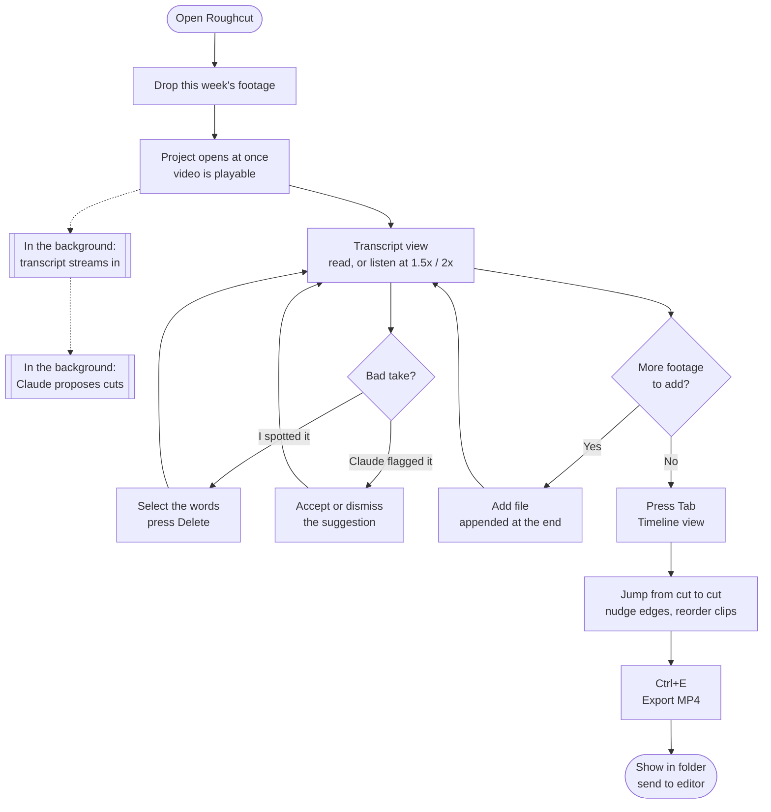

**A typical weekly session**

| Step | What you do | Your attention |
| --- | --- | --- |
| 1 | Drop the recording on the window. Start reading right away while the transcript fills in. | seconds |
| 2 | Step through Claude's suggestions with `N`, pressing `A` to cut or `D` to keep. | 2–3 min |
| 3 | Skim the rest of the transcript, playing at 2x where unsure. Select and `Delete` anything else. | 5–8 min |
| 4 | If there is a second recording, drop it in. It lands at the end. Repeat steps 2–3 for it. | as needed |
| 5 | `Tab` to the timeline. Hop between cuts with `↑` `↓`, preview each with `/`, nudge the ones that sound clipped. | 2–3 min |
| 6 | `Ctrl+E`, `Enter`. Wait for the export, then send the file. | 1 min + export time |

## 1.6 Use cases

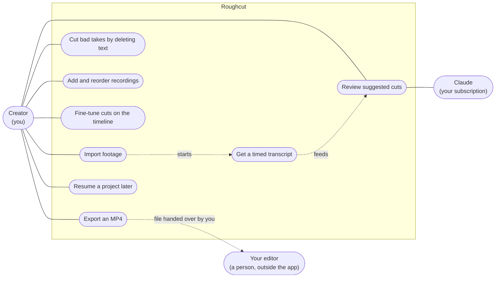

| # | Use case | Trigger | Result |
| --- | --- | --- | --- |
| UC1 | Import footage | Drop a file on the window, or `Ctrl+N` | A project opens immediately. The video is playable; nothing is uploaded or copied. |
| UC2 | Get a timed transcript | Automatic after import | Text appears progressively, top to bottom, while you already work. |
| UC3 | Review suggested cuts | Automatic once the transcript is ready | Retakes, false starts and "let me redo that" moments are highlighted with a reason. Nothing is cut until you accept. |
| UC4 | Cut bad takes by deleting text | Select words, press `Delete` | The matching video is removed from the sequence. The text stays visible, struck through. |
| UC5 | Add and reorder recordings | Drop another file, or `Ctrl+O` | The new recording is appended to the end of the sequence. Clips can be moved earlier or later on the timeline. |
| UC6 | Fine-tune cuts on the timeline | `Tab` | Frame-accurate adjustment of any cut point, splitting, removing and reordering clips. |
| UC7 | Export an MP4 | `Ctrl+E` | One MP4 of the sequence, saved where you last saved, ready to send. |
| UC8 | Resume a project later | Pick it on the home screen | Everything is exactly as you left it, including undo history for the session's edits. |

## 1.7 Screens

There are three screens: **Home**, **Editor** (with two views, Transcript and Timeline), and the **Export** dialog. All figures in the mockups are illustrative.

**Visual mockups:** [mockups/roughcut-mockups.html](mockups/roughcut-mockups.html) shows all five screens in the intended look (open it in a browser; keys `1` to `5` switch screens). A screenshot of each screen is shown under its heading below. It is the current design. The text diagrams below are the earlier, busier draft, kept for the detail they list; where the two differ, the HTML file wins.

### A. Home

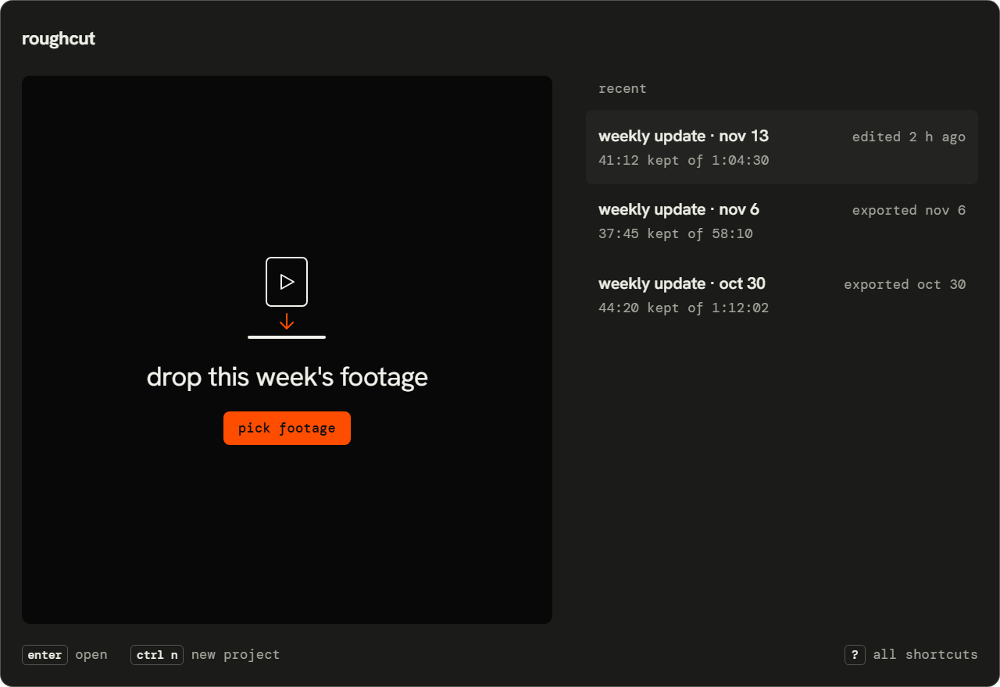

Shown at launch. The most recent project is preselected, so `Enter` resumes it.

```text
┌──────────────────────────────────────────────────────────────────────────────┐
│ Roughcut                                                         ? shortcuts │
├──────────────────────────────────────────────────────────────────────────────┤
│                                                                              │
│              ┌──────────────────────────────────────────────────┐            │
│              │                                                  │            │
│              │          Drop this week's footage here           │            │
│              │          or press Ctrl+N to pick a file          │            │
│              │                                                  │            │
│              └──────────────────────────────────────────────────┘            │
│                                                                              │
│ Recent                                                                       │
│ > Weekly update - Nov 13     1:04:30 raw   41:12 kept         edited 2 h ago │
│   Weekly update - Nov 6        58:10 raw   37:45 kept         exported Nov 6 │
│   Weekly update - Oct 30     1:12:02 raw   44:20 kept        exported Oct 30 │
│                                                                              │
├──────────────────────────────────────────────────────────────────────────────┤
│ Up/Down select    Enter open    Ctrl+N new project    Del remove from list   │
└──────────────────────────────────────────────────────────────────────────────┘
```

### B. Editor while the transcript is still being produced

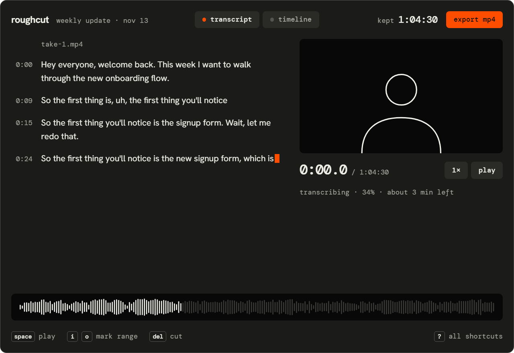

The project opens the moment you drop the file. You are never blocked: you can play, scrub, mark ranges with `I` / `O` and cut on the timeline before any text exists.

```text
┌──────────────────────────────────────────────────────────┐
│ Transcribing  34%                       about 3 min left │
│ ███████████████████░░░░░░░░░░░░░░░░░░░░░░░░░░░░░░░░░░░░░ │
├──────────────────────────────────────────────────────────┤
│                                                          │
│  0:00  Hey everyone, welcome back. This week I want to   │
│        walk through the new onboarding flow.             │
│                                                          │
│  0:09  So the first thing is, uh, the first thing        │
│        you'll notice                                     │
│                                                          │
│        ...  text appears here as it is transcribed       │
│                                                          │
├──────────────────────────────────────────────────────────┤
│ You can already play, scrub, mark ranges and cut.        │
└──────────────────────────────────────────────────────────┘
```

### C. Editor — Transcript view (the default)

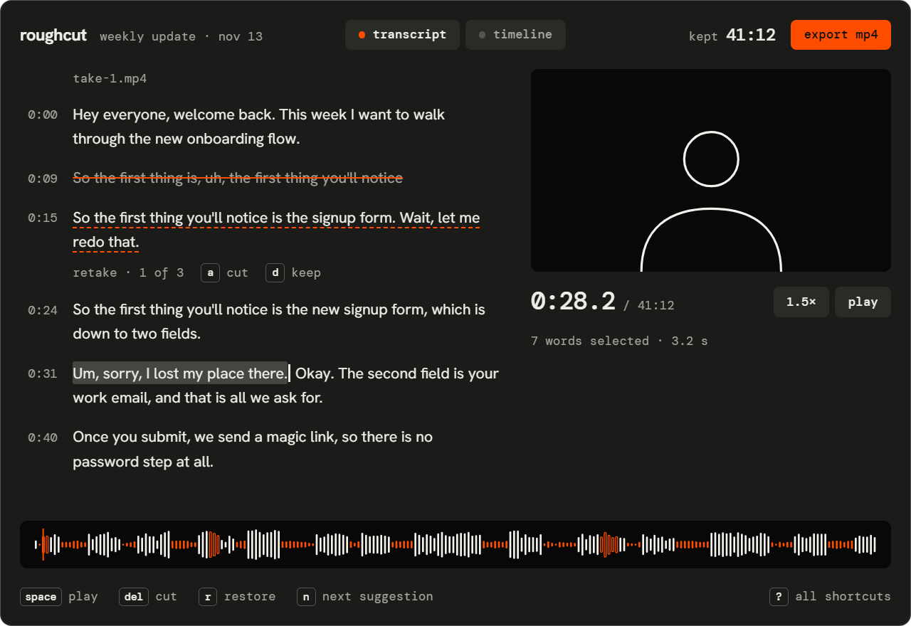

Transcript on the left, player on the right, a thin overview of the whole sequence along the bottom.

```text
┌────────────────────────────────────────────────────────────────────────────────────────────────┐
│ Weekly update - Nov 13         [ TRANSCRIPT ]   Timeline     Tab         41:12 kept     Export │
├──────────────────────────────────────────────────────────┬─────────────────────────────────────┤
│ Find  Ctrl+F                      3 suggestions   N next │                                     │
│                                                          │ ┌─────────────────────────────────┐ │
│ ── TAKE-1.mp4 ────────────────────────────────────────── │ │                                 │ │
│                                                          │ │                                 │ │
│  0:00  Hey everyone, welcome back. This week I want to   │ │                                 │ │
│        walk through the new onboarding flow.             │ │           VIDEO PLAYER          │ │
│                                                          │ │                                 │ │
│  0:09  ~~So the first thing is, uh, the first thing~~    │ │                                 │ │
│        ~~you'll notice~~  (pause 3.1s)                   │ │                                 │ │
│                                                          │ └─────────────────────────────────┘ │
│  0:15 ┃So the first thing you'll notice is the signup    │  > 0:27.4 / 41:12             1.5x  │
│       ┃form. Wait, let me redo that.                     │                                     │
│       ┗ Retake, said again at 0:24     A cut   D keep    │ ─────────────────────────────────── │
│                                                          │  Selection                          │
│  0:24  So the first thing you'll notice is the new       │  nothing selected                   │
│        ▌signup form, which is down to two fields.        │                                     │
│                                                          │  Caret                              │
│ ── SCREEN-DEMO.mp4 ───────────────────────────────────── │  TAKE-1.mp4 at 0:27.4               │
│                                                          │                                     │
│ 31:40  Okay, let me share my screen and show you how     │                                     │
│        this works in practice.                           │                                     │
│                                                          │                                     │
├──────────────────────────────────────────────────────────┴─────────────────────────────────────┤
│ ████████░░░░░▒▒▒▒▒▒███┃████████████████████████░░░██████████████░░░░░░████████████████████████ │
│ 0:00                                                                                     41:12 │
├────────────────────────────────────────────────────────────────────────────────────────────────┤
│ Space play   Del cut   R restore   I / O mark range   N next suggestion   H hide cuts   ? all  │
└────────────────────────────────────────────────────────────────────────────────────────────────┘
```

Reading the mockup:

- `~~text~~` is cut text: shown struck through and dimmed in the real interface.
- `(pause 3.1s)` is a pause chip. It selects and deletes like a word.
- The block marked with a bar on its left is a suggestion from Claude, with its reason underneath.
- `▌` is the caret. It follows playback, and moving it moves the playhead.
- In the overview strip: `█` kept, `░` cut, `▒` suggested, `┃` playhead.

### D. Editor — Timeline view

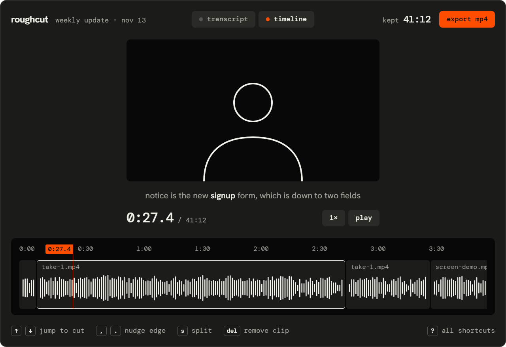

Same sequence, shown as clips. Large player on top with a one-line caption of the words around the playhead, a single track underneath.

```text
┌────────────────────────────────────────────────────────────────────────────────────────────────┐
│ Weekly update - Nov 13           Transcript   [ TIMELINE ]   Tab         41:12 kept     Export │
├────────────────────────────────────────────────────────────────────────────────────────────────┤
│                                                                                                │
│                      ┌──────────────────────────────────────────────────┐                      │
│                      │                                                  │                      │
│                      │                                                  │                      │
│                      │                   VIDEO PLAYER                   │                      │
│                      │                                                  │                      │
│                      │                                                  │                      │
│                      └──────────────────────────────────────────────────┘                      │
│           ...you'll notice is the new [signup] form, which is down to two fields...            │
│                       > 0:27.4 / 41:12          1x          cut 2 of 14                        │
│                                                                                                │
├────────────────────────────────────────────────────────────────────────────────────────────────┤
│ 0:00         0:09                          2:47        3:31                              41:12 │
│                        ▼                                                                       │
│ ┌ 1 ─────────┐╔ 2 ═════════════════════════╗┌ 3 ───────┐┌ 4 ────────────────────────────────┐  │
│ │ TAKE-1     │║ TAKE-1                     ║│ TAKE-1   ││ SCREEN-DEMO                       │  │
│ │▓▓▓▓▒▒▒▒▓▓▓▓│║▓▓▓▓▒▒▒▒▓▓▓▓▒▒▒▒▓▓▓▓▒▒▒▒▓▓▓▓║│▓▓▓▓▒▒▒▒▓▓││▓▓▓▓▒▒▒▒▓▓▓▓▒▒▒▒▓▓▓▓▒▒▒▒▓▓▓▓▒▒▒▒▓▓▓│  │
│ │▁▂▃▅▇▅▃▂▁▁▃▅│║▅▃▂▁▁▃▅▇▇▅▃▂▃▅▇▅▂▁▁▂▃▅▇▅▃▂▁▁║│▃▅▇▇▅▃▂▃▅▇││▃▂▃▅▇▅▂▁▁▂▃▅▇▅▃▂▁▁▃▅▇▇▅▃▂▃▅▇▅▂▁▁▂▃▅│  │
│ └────────────┘╚════════════════════════════╝└──────────┘└───────────────────────────────────┘  │
│                                                                                                │
│ Clip 2 of 4   from TAKE-1.mp4 0:24.1 to 3:02.7   length 2:38.6                       zoom: fit │
├────────────────────────────────────────────────────────────────────────────────────────────────┤
│ Up/Down prev/next cut   , . nudge edge   Q W trim to playhead   S split   Del remove   ? all   │
└────────────────────────────────────────────────────────────────────────────────────────────────┘
```

Reading the mockup:

- The double-bordered clip is the one under the playhead.
- Each clip shows a thumbnail strip and its sound wave, so you can see where speech starts and stops.
- There is exactly one track. Clips always touch; there are never gaps or overlaps.

### E. Export

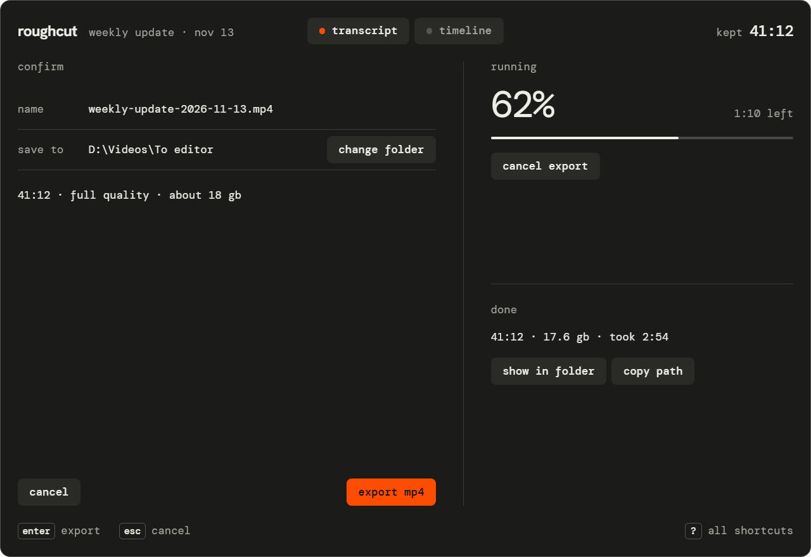

```text
1. Confirm
┌──────────────────────────────────────────────────────────────┐
│ Export                                                Ctrl+E │
├──────────────────────────────────────────────────────────────┤
│                                                              │
│  Name       weekly-update-2026-11-13.mp4                     │
│  Save to    D:\Videos\To editor                   Change  C  │
│                                                              │
│  Length 41:12          Size ~18 GB          Time ~3 min      │
│                                                              │
├──────────────────────────────────────────────────────────────┤
│                            Cancel  Esc        Export  Enter  │
└──────────────────────────────────────────────────────────────┘

2. Progress
┌──────────────────────────────────────────────────────────────┐
│ Exporting weekly-update-2026-11-13.mp4                       │
│                                                              │
│ ████████████████████████░░░░░░░░░░░░░░░     62%    1:10 left │
│                                                              │
│                                                 Cancel  Esc  │
└──────────────────────────────────────────────────────────────┘

3. Done
┌──────────────────────────────────────────────────────────────┐
│ Done   41:12   17.6 GB   took 2:54                           │
│                                                              │
│  Show in folder  Enter      Copy path  C         Close  Esc  │
└──────────────────────────────────────────────────────────────┘
```

## 1.8 How editing behaves

### In the transcript

1. **The transcript is the sequence written out as text**, in the order it will play. Each source gets a header line.
2. **Words are the unit.** Selections snap to whole words. Pauses longer than about a second appear as pause chips and behave like words.
3. **Delete cuts.** Cut text stays where it was, struck through and dimmed, so you can see what you removed. `H` hides or shows cut text.
4. **Restore un-cuts.** Select struck-through text and press `R`, or undo.
5. **Nothing is ever destroyed.** Source files are never touched. Every cut can be restored at any time, in any session.
6. **Caret and playhead are the same thing.** Playback moves the caret; moving the caret moves the playhead. `Enter` plays from the caret.
7. **Playback skips cuts.** What you hear while playing in the editor is what the export will contain.
8. **Cuts land in the silence between words**, not flush against a syllable, so a text cut rarely sounds clipped. The timeline is there for the ones that do.
9. **Mark while listening.** Press `I` where a bad take starts and `O` where it ends, then `Delete`. Useful at 2x and before the transcript is ready.
10. **Find.** `Ctrl+F` searches kept and cut text and jumps to each match.
11. **The text itself is not editable.** The transcript is a handle on the video, not a document. There is no typo fixing.

### On the timeline

1. **One track, always closed up.** Removing or shortening a clip pulls everything after it earlier. Lengthening pushes everything later. You cannot create a gap.
2. **Every cut made in the transcript is a clip boundary here**, and every change here is reflected in the transcript (trimming an edge strikes or restores the words it covers).
3. **Edges can move both ways.** Pulling an edge outwards brings back material you previously cut, up to the next kept material or the end of the source.
4. **Four clip operations:** trim an edge, split at the playhead, remove a clip, move a clip earlier or later. That is the whole list.
5. **Preview a cut** with `/`: plays from two seconds before the nearest cut to two seconds after.
6. **Mouse works too:** drag an edge to trim, drag a clip to reorder, click to place the playhead, scroll to zoom.

### Everywhere

- **Undo and redo** cover every edit in both views, without limit, for the session.
- **Autosave.** There is no save command. Closing the app loses nothing.

## 1.9 What Claude does

After the transcript is ready, Claude reads it and proposes cuts. It looks for:

| Kind | Example | What is proposed |
| --- | --- | --- |
| **Retake** | The same line said two or three times | Cut the earlier attempts, keep the last complete one |
| **False start** | A sentence abandoned halfway and restarted | Cut the abandoned part |
| **Out-of-script moment** | "Wait, let me redo that", "okay, starting over", talking to yourself | Cut the aside, and the take it refers to |
| **Dead air** | Long silences between takes | Cut the pause |

Rules:

- **Claude only suggests.** Nothing is removed until you press `A`. `Shift+A` accepts all remaining suggestions at once.
- Each suggestion shows a short reason and, for retakes, where the kept version is.
- A dismissed suggestion does not come back.
- **You sign in with your Claude account once.** No API key, no separate bill.
- **The app is fully usable without Claude.** If you are signed out, offline or over your usage limit, you get a one-line notice, no suggestions, and everything else works.
- **Privacy:** video and audio never leave your computer. Speech is transcribed on your PC; only the transcript text is sent to Claude.

## 1.10 Keyboard shortcuts

Every action is reachable from the keyboard. `?` shows this list in the app at any time. Defaults below assume a QWERTY layout and can be remapped.

**Everywhere**

| Key | Action |
| --- | --- |
| `Space` | Play / pause |
| `J` `K` `L` | Play backwards / pause / play forwards. Press `L` again to go faster. Backwards is silent |
| `1` `2` `3` | Playback speed 1x / 1.5x / 2x |
| `Tab` | Switch between Transcript and Timeline |
| `Ctrl+Z` / `Ctrl+Shift+Z` | Undo / redo |
| `Ctrl+N` | New project from footage |
| `Ctrl+O` | Add footage to this project |
| `Ctrl+E` | Export |
| `Ctrl+F` | Find in transcript |
| `?` | Show shortcuts |
| `Esc` | Close dialog, clear selection |

**Transcript view**

| Key | Action |
| --- | --- |
| `←` `→` | Move by word |
| `↑` `↓` | Move by line |
| `Ctrl+←` `Ctrl+→` | Move by sentence |
| `Ctrl+↑` `Ctrl+↓` | Move by paragraph |
| `Shift` + any of the above | Extend the selection |
| `Delete` or `Backspace` | Cut the selection (or the word at the caret) |
| `R` | Restore the selection |
| `I` / `O` | Mark the start / end of a range at the playhead |
| `Enter` | Play from the caret |
| `H` | Hide / show cut text |
| `N` / `Shift+N` | Next / previous suggestion |
| `A` / `D` | Accept (cut) / dismiss (keep) the current suggestion |
| `Shift+A` | Accept all remaining suggestions |

**Timeline view**

| Key | Action |
| --- | --- |
| `←` `→` | Step one frame |
| `Shift+←` `Shift+→` | Step one second |
| `↑` `↓` | Jump to previous / next cut |
| `,` `.` | Nudge the end of the clip before the cut, one frame earlier / later |
| `Shift+,` `Shift+.` | Nudge the start of the clip after the cut, one frame earlier / later |
| `Q` / `W` | Trim the clip's start / end to the playhead |
| `S` | Split at the playhead |
| `Delete` | Remove the clip under the playhead |
| `Alt+←` `Alt+→` | Move the clip earlier / later |
| `/` | Preview the nearest cut |
| `+` `-` `0` | Zoom in / zoom out / fit everything |

## 1.11 Speed expectations

These are the targets the How must meet for a one-hour 4K source on your machine. They will be confirmed or revised in Part 2 once the hardware is known.

| Moment | Target |
| --- | --- |
| Launch to home screen | Under 2 seconds |
| Drop a file to playable project | Under 5 seconds. No upload, no copy |
| First transcript text visible | Under 30 seconds |
| Full transcript of one hour | A few minutes, in the background |
| Suggestions after transcript | Under a minute, in the background |
| Any cut, restore, trim or undo | Instant (no visible delay) |
| Scrubbing and jumping around | Smooth, including at 2x |
| Export of the finished sequence | Minutes, and always much faster than real time |

## 1.12 States and edge cases

| Situation | What you see |
| --- | --- |
| Transcript not ready yet | Progress line above the text. Playing, marking ranges and timeline editing already work. |
| Footage with no speech | Empty transcript with a note. The timeline works as normal. |
| Speech the transcriber could not turn into words | An "unrecognised speech" block in the transcript. It can be played, kept or cut like any text. |
| A source file was moved or deleted | The project opens with a "Locate file" prompt for that source. Edits are intact. |
| Sources with different resolutions or frame rates | Allowed. The export follows the first clip's format; a one-line notice says so. |
| Recording with several audio tracks | All tracks are kept in the export. The transcript uses the microphone track. |
| Claude unavailable or over the usage limit | One-line notice with a retry. No suggestions; everything else works. |
| Not enough disk space to export | Checked before the export starts, with the amount needed. |
| App closed or crashed mid-edit | Reopening restores the project to the last edit. |
| Export cancelled or interrupted | The partial file is removed. The project is untouched. |
| Everything was cut | Export is disabled with a note. |

## 1.13 Out of scope

Deliberately not in this product:

- More than one video track, picture-in-picture, multi-camera, syncing separate camera and screen recordings
- Transitions, titles, text overlays, zooms, crops, colour, filters
- Music, sound effects, audio clean-up, volume automation
- Captions or subtitle files, editing the transcript's wording, speaker labels
- Cloud storage, sharing links, collaboration, comments
- Sending the file to the editor, publishing to any platform
- Export formats other than MP4

## 1.14 Assumptions made

Correct any of these and Part 1 changes accordingly.

1. **Desktop app, local files.** "Upload" in your brief is treated as "import": the app runs on your Windows PC and reads the file where it is, because actually uploading tens of gigabytes of 4K would be the slowest step of the week.
2. **One recording = one file with picture and sound together.** No syncing of separate camera and screen recordings.
3. **Single user, single computer.** No accounts beyond the Claude sign-in.
4. **Your editor wants full quality.** Export defaults to the source's resolution and quality.
5. **The transcript is for cutting only.** It is not exported and its wording does not need to be perfect.

## 1.15 Decisions from validation

Part 1 was validated on 13 Nov 2026 with these answers.

| Question | Decision |
| --- | --- |
| Claude's role | Accepted: a speech model on the PC makes the transcript; Claude, on the subscription, proposes the cuts. The speech model should be the best that fits the RTX 4070 SUPER (see 2.4.4). |
| Platform | Windows only |
| Language | English |
| Export | Full quality only. The "smaller file" option is removed. |
| Keyboard | QWERTY |
| Suggestions in the first version | Not answered; assumed yes, since they are the main use of Claude. |
| Look | Dark, Teenage Engineering style, as in the HTML mockups. |

---

# Part 2 — The How

## 2.1 The approach in one paragraph

Roughcut is a Windows desktop app with a web-technology interface and a small native core. It never modifies or copies your footage. On import it builds three disposable helpers in the background: a small, fast-seeking **proxy** video for editing, a **transcript** with a time for every word (made on your PC by a speech model), and a list of **suggested cuts** (made by Claude, through the Claude Code already installed on this PC, on your subscription). Every edit is a change to one small list of clips, so edits are instant and undo is trivial. Export re-reads the original 4K files and encodes only the parts you kept, on the graphics card.

| Area | Decision |
| --- | --- |
| App shell | Tauri 2: Rust core, interface in TypeScript + React, rendered by the WebView2 already on this PC |
| Media engine | A pinned FFmpeg build shipped inside the app, using the RTX 4070 SUPER for decode and encode |
| Editing media | Edit on a 720p short-GOP proxy; export from the originals |
| Playback | Two stacked HTML video elements that hand over at each cut |
| Speech-to-text | NVIDIA Parakeet TDT 0.6B (English) on sherpa-onnx with Silero VAD, behind a swappable interface; bake-off against Qwen3-ASR-1.7B on a real recording before it is locked |
| Claude | The app runs the installed `claude` CLI non-interactively; transcript text in, schema-checked JSON out |
| Edit model | One ordered list of clips is the only source of truth; transcript and timeline are both derived from it |
| Export | Frame-accurate re-encode with NVENC at visually lossless quality, clip by clip, then joined |
| Storage | One small JSON file per project; a disposable cache per source file |

## 2.2 Facts the design rests on

Checked on this PC on 13 Nov 2026:

| Item | Finding | Consequence |
| --- | --- | --- |
| Graphics card | RTX 4070 SUPER, 12 GB, driver 617.14 | Hardware decode and encode (NVDEC, NVENC) and CUDA are available |
| Processor, memory | Ryzen 7 5700X (8 cores), 32 GB | Enough to transcribe on the processor alone if the GPU path fails |
| WebView2 runtime | Installed, version 157 | The interface needs no browser engine shipped with the app |
| Claude Code | Installed, version 2.1.323 | The Claude integration can use it as is |
| FFmpeg | Not installed | Shipped inside the app |
| Rust, Node.js | Not found | Needed to build the app, not to run it; installed as the first build step |

Checked in documentation:

- **Claude takes no audio.** I found no official statement that the Claude API accepts audio input, and Claude Code's own issue tracker has open requests for it. Third-party pages disagree with each other. The design does not depend on it either way: even a model that hears audio would not return a reliable time for every word, which transcript editing needs.
- **Claude Code can be scripted on a subscription.** `claude -p` uses the stored subscription login, returns JSON that matches a schema you give it, can run with all tools disabled, and `claude auth status` reports login state without making a model call.
- **Allowed use.** Anthropic's terms forbid third-party developers from offering Claude.ai login in their apps or routing requests through plan credentials on behalf of their users, and state this does not prevent an end user signing in to the unmodified Claude Code binary with their own subscription. Roughcut never sees your credentials; it runs your own installed, unmodified `claude`. My reading is that this is the permitted case for a personal tool. If Roughcut were ever distributed to other people, it would have to use API keys instead.

## 2.3 Architecture

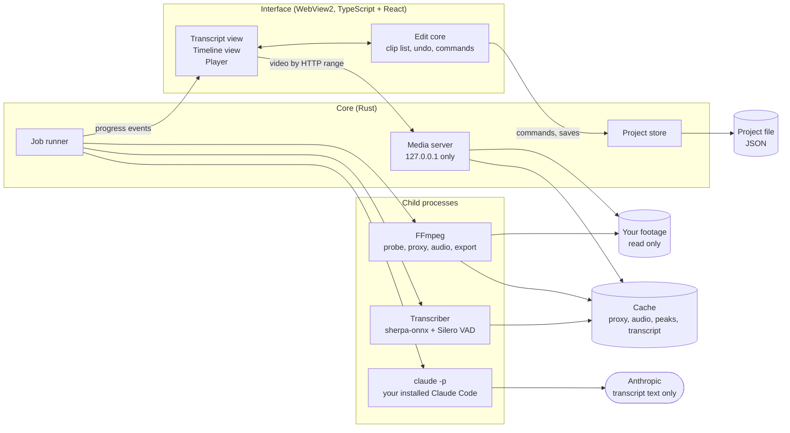

| Part | Runs as | Responsibility |
| --- | --- | --- |
| Interface | WebView2 page | Everything you see and every keystroke. Holds the edit core, so edits never wait on another process. |
| Core | The app's main process (Rust) | Starts and supervises background jobs, saves projects, serves media to the player, talks to the file system. |
| FFmpeg | Child process per task | Reads footage; makes the proxy, the audio for transcription and the export. |
| Transcriber | Child process per source | Turns audio into timed words. Its own process so a crash or a model swap cannot take the app down, and so graphics memory is released when it ends. |
| Claude | Child process per request | One call per source: transcript in, suggestions out. |

Nothing listens on the network except the media server, which binds to this machine only and requires a per-launch token.

## 2.4 Decisions

### 2.4.1 App shell: Tauri 2

- **Why:** starts fast and uses little memory, because it reuses the WebView2 already on Windows 11 instead of shipping a browser. The Rust core is a good fit for supervising FFmpeg, the transcriber and Claude, and can link the speech runtime directly.
- **Alternative considered:** Electron. One language throughout and very well-trodden for video, but heavier, and it still needs native helpers for speech. It remains the fallback if WebView2's video behaviour disappoints (see risk 4); the interface code would carry over, the core would not.
- **Not considered further:** a fully native interface. The interface in the mockups is cheapest to build and iterate as a web page.

### 2.4.2 Originals, proxy and time

- **Originals are read-only inputs.** Nothing is ever written next to them.
- **Proxy:** on import, FFmpeg makes a 1280×720 H.264 copy with a keyframe every half second, constant frame rate, and the audio tracks mixed to stereo. Short keyframe spacing is what makes scrubbing, frame stepping and cut handover feel instant. One hour is roughly 1 GB.
- **While the proxy is being made** (an estimated 5 to 8 minutes for an hour of 4K), the player uses the original file directly if WebView2 can play it, which is expected for MP4 and MOV. When the proxy is ready the player switches to it without changing position. If the original cannot be played directly, the player becomes available when the proxy is ready; reading and cutting by text work meanwhile.
- **One timebase:** every time in a project is a position in a source file, stored as whole microseconds. Proxy and original share the same clock, so swapping them changes nothing in the edit.
- **Frame grid:** clip edges always snap to frame boundaries of the sequence frame rate (taken from the first source). This keeps picture and sound the same length in every clip, which is what prevents drift at export.
- **Variable frame rate recordings** are handled by converting to constant frame rate in both proxy and export, preserving wall-clock time.

### 2.4.3 Playback and skipping cuts

- **Two video elements, one visible.** The visible one plays the current clip. The hidden one is already paused on the first frame of the next clip. When the visible one reaches the clip's end, they swap within a frame. This is how playback crosses a cut without a pause.
- **Sound at a cut** gets a ramp of a few milliseconds on each side to avoid clicks.
- **1.5× and 2×** use the browser's built-in pitch-preserving speed change.
- **Playing backwards** (`J`) is done as rapid backward steps without sound, because browsers cannot play video in reverse.
- **Timing source:** the frame callback of the video element, which reports the exact media time of each displayed frame. The caret in the transcript and the playhead on the timeline both follow it.

### 2.4.4 Speech-to-text

You asked for the best model that fits the 4070 SUPER. For this product "best" is not only accuracy. In priority order the model must: give a time for every word; keep retakes, false starts and fillers instead of tidying them away; stay silent during silence; be accurate; and run on Windows without a Python installation.

| Model | Error rate (lower is better) | Word times | Runs natively on Windows without Python | Licence | Verdict |
| --- | --- | --- | --- | --- | --- |
| Qwen3-ASR-1.7B + its aligner | 6.15% | Separate aligner, about 37 ms mean error | No mature route | Apache-2.0 | Most accurate on paper; challenger in the bake-off |
| Granite Speech 5.0 2B | 6.68% | None | No | Apache-2.0 | Rejected: no word times |
| Cohere Transcribe 2B | 6.72% | None | No | Apache-2.0 | Rejected: no word times |
| Canary-Qwen 2.5B | 6.92% | None | No | CC-BY-4.0 | Rejected: no word times |
| **Parakeet TDT 0.6B v2** | 6.93% | Native | Yes, sherpa-onnx | CC-BY-4.0 | **Default** |
| Parakeet TDT 0.6B v3 | 7.04% | Native | Yes, sherpa-onnx | CC-BY-4.0 | Also in the bake-off |
| Whisper large-v3 | 8.24% | Approximate | Yes | MIT / Apache-2.0 | Rejected: drops fillers, can invent text in silence |
| CrisperWhisper | not listed | Very good | Yes | Non-commercial | Rejected: licence excludes work use |

Error rates are the Hugging Face Open ASR Leaderboard averages as read on 13 Nov 2026 by a research pass; the leaderboard changed its test sets recently, so older articles quote lower numbers. Treat them as approximate. NVIDIA's newest model (Nemotron 3.5 Transcribe) needs about 80 GB and does not fit.

- **Default: Parakeet TDT 0.6B v2.** It is the only family that satisfies every requirement at once: native word times, no invented text in silence, a ready-made Windows runtime (sherpa-onnx, prebuilt for CUDA 12), and a licence that allows work use. It is small, so the 4070 SUPER is used for speed, not because the model needs it: an hour should take about a minute on the GPU and 3 to 4 minutes on the processor alone.
- **Why not simply the most accurate one:** Qwen3-ASR's gain is under one point of error rate. It needs a second model for word times, its official runtime is Python and PyTorch, and models built on a language model tend to tidy speech, which would hide exactly the retakes you want to see. None of that is proven either way.
- **The evidence on keeping retakes is thin for every model**, including Parakeet (there is one user report of v2 skipping repeated words). So the choice is settled by measurement, not by this table: **the first build task is a bake-off** of Parakeet v2, Parakeet v3 and Qwen3-ASR-1.7B on one of your real recordings, scored on retakes kept, word-time accuracy and speed. The winner becomes the default.
- **Swappable by design:** the transcriber is a separate process with one small contract (audio in, timed words out), so changing the model does not touch the rest of the app.
- **Voice activity detection:** Silero VAD splits the audio into speech and silence before transcription. This keeps the model from seeing long silences, lets text appear progressively, and gives the pause lengths shown in the transcript.
- **Safety net:** any stretch the detector hears as speech but the model returns no words for is shown in the transcript as an "unrecognised speech" block that can be played, kept or cut. Speech can never be silently missing from the text view.

### 2.4.5 From words to cuts

- **Word ends are tightened.** Parakeet's word times can stretch across a following pause, so each word's end is clamped using the voice detector and the sound level.
- **A cut lands in the quietest point of the gap** between the last kept word and the first cut word (and likewise on the other side), then snaps to the frame grid. This is what makes text cuts sound clean without manual trimming.
- **Paragraphs** are formed by splitting at pauses and sentence punctuation. Pauses longer than about a second become pause chips.

### 2.4.6 Claude suggestions

- **How it is called:** the core runs `claude -p` with the transcript on standard input, a system prompt that replaces Claude Code's default, all tools disabled, session saving off, and a JSON schema for the answer. The app does not use `--bare`, because bare mode ignores the subscription login.
- **What is sent:** the transcript as numbered utterances with their start times and the length of the pause after each. About 15,000 tokens for an hour. No audio, no video, no file paths.
- **What comes back:** a list of suggestions, each with a kind (retake, false start, aside), the utterance range it covers, a quoted span so the app can locate the exact words, a one-line reason, and for a retake the utterance to keep. The app maps these to word ranges and discards any it cannot locate.
- **Dead air is found locally** from the voice detector, not by Claude, so pause suggestions work even when Claude is unavailable.
- **Isolation:** the call runs in an empty temporary folder with your personal Claude Code settings, project instructions and tool servers left out, so nothing from your coding setup leaks into it. `ANTHROPIC_API_KEY` is removed from the child's environment, because Claude Code would otherwise prefer it and bill the API instead of the subscription.
- **Model:** the `opus` alias by default, changeable in one setting. One call per source file.
- **Failure handling:** the app checks `claude auth status` first. Not signed in, usage limit reached or offline each produce the one-line notice from Part 1, with a retry.

### 2.4.7 Edit model and undo

- **The sequence is an ordered list of clips,** each one a source file plus a start and an end. That list is the whole edit.
- **Nothing else is stored about cuts.** A word is "kept" if it lies inside a clip. The transcript view and the timeline view are both computed from the list, so they cannot disagree.
- **Every action is a named command** (cut range, restore range, trim edge, split, remove clip, move clip, accept suggestion). Keyboard shortcuts map to commands, which is what makes the shortcut list, remapping and testing straightforward.
- **Edits run in the interface process** and complete within a frame. Saving happens afterwards, in the background.
- **Undo** keeps previous versions of the clip list. They are tiny, so history is effectively unlimited and is saved with the project.

### 2.4.8 Export

- **Method:** each kept clip is decoded from the original on the GPU and re-encoded with NVENC as its own piece; the pieces, which share identical settings, are then joined without further encoding. Audio is rendered in one pass for the whole sequence, with the same few-millisecond ramps at cuts used in preview, and combined with the joined video.
- **Why clip by clip:** FFmpeg seeks straight to each clip instead of decoding the footage you cut, progress is exact, and a cancelled export leaves nothing half-written at the destination.
- **Quality:** constant-quality encoding at a visually lossless setting, at the source's resolution, frame rate and bit depth, in the source's codec family (H.264 stays H.264, HEVC stays HEVC). All audio tracks are kept.
- **What "full quality" means here:** this is one extra generation of encoding, tuned so the difference is not visible. It is not a bit-for-bit copy.
- **Alternative rejected for the first version:** copying the original video data untouched and re-encoding only around each cut. It is truly lossless and faster, but joins made that way are a known source of glitches in editing software, and your editor's software is where this file goes next.
- **Measured speed:** about 3.5 times real time for 4K at 30 frames per second on this PC (53.8 minutes of 4K with 300 cuts exported in 15.4 minutes), so roughly 12 minutes for a 41-minute result. The first estimate here was 4 to 6 times; the export spike and the finished app both measured about 3 to 3.5 times, and that was accepted. It is slower than the "about 3 min" shown in the mockup.
- **Mixed sources** are scaled to the first clip's format while encoding.

### 2.4.9 Storage

| What | Where | Notes |
| --- | --- | --- |
| Project | `%APPDATA%\Roughcut\projects\<id>\project.json` | Sources, clip list, undo history, dismissed suggestions. Small. Written atomically after each edit. |
| Cache | `%LOCALAPPDATA%\Roughcut\cache\<source fingerprint>\` | Proxy, transcription audio, waveform, voice-detector result, transcript, suggestions. Can be deleted at any time and is rebuilt on demand. |
| Settings | `%APPDATA%\Roughcut\settings.json` | Export folder, key bindings, Claude model, cache size limit. |
| Speech model | Downloaded once on first run into the app's data folder | About 0.6 to 2.5 GB depending on the bake-off winner. |

A source is identified by a fingerprint of its size, modified time and a sample of its content, so moving or renaming a file does not lose the cached work, and "Locate file" can verify it found the right one.

### 2.4.10 Background jobs

- **One job runner** in the core owns all long work: probe, proxy, audio extraction, voice detection, transcription, suggestions, export.
- **Jobs report progress as events** to the interface and write their results to the cache, so a finished job is never repeated and an interrupted one restarts cleanly.
- **Order on import:** probe first (instant), then proxy and audio extraction in parallel, transcription streaming as audio arrives, suggestions when the transcript is complete.
- **The GPU is shared** between the proxy encode and transcription; the speech model needs under 2 GB of the 12 GB.

### 2.4.11 Interface technology

- **React + TypeScript**, built with Vite.
- **Transcript view:** ordinary page elements, drawn only for the paragraphs on screen so an hour of text stays fast. The caret and selection are the app's own, word by word, not the browser's text editing.
- **Timeline and overview strip:** drawn on a canvas from precomputed waveform data.
- **Look:** the tokens, type and components of `mockups/roughcut-mockups.html` carry over directly.

## 2.5 What happens on import

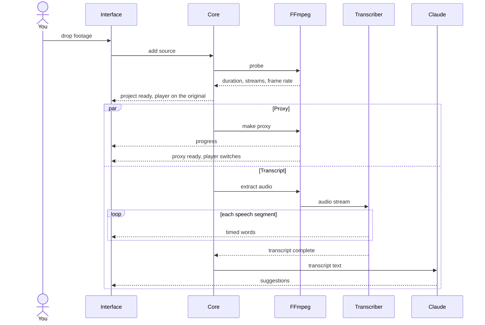

## 2.6 Speed budget

Targets are from Part 1. "Expected" figures are estimates until the spikes in 2.8 measure them.

| Moment | Target | How it is met | Expected |
| --- | --- | --- | --- |
| Launch | Under 2 s | Small native shell, system WebView2, no work at startup | Meets |
| Drop to playable | Under 5 s | Probe only; player starts on the original | Meets for MP4 and MOV; other containers wait for the proxy |
| First text | Under 30 s | Audio is streamed to the transcriber while it is still being read | Meets |
| Full transcript, 1 h | A few minutes | Parakeet on the GPU, or on the processor as fallback | About 1 min on GPU, 3 to 4 min on processor |
| Suggestions | Under 1 min after transcript | One Claude call of about 15,000 tokens | Meets, subject to Claude's response time |
| Any edit | Instant | Edit core in the interface process; list of clips only | Under one frame |
| Scrubbing | Smooth | Half-second keyframes in the proxy | Meets once the proxy is ready; slower on the original before that |
| Export | Much faster than real time | Clip-by-clip NVENC | About 3.5 × real time for 4K30 (measured) |

## 2.7 What is installed and shipped

| Item | Shipped in the app | Needed on the PC |
| --- | --- | --- |
| Roughcut itself | Yes | |
| FFmpeg (pinned build with NVENC) | Yes | |
| sherpa-onnx with its CUDA 12 and cuDNN 9 libraries | Yes | Current NVIDIA driver (present) |
| Speech model | Downloaded on first run | |
| WebView2 | | Present |
| Claude Code, signed in | | Present |
| Rust and Node.js | | Only to build the app |

## 2.8 Risks, and the spike that retires each

| # | Risk | Spike or mitigation |
| --- | --- | --- |
| 1 | The speech model drops retakes or fillers, which would hide what you need to see | Bake-off on a real recording before anything else is built. The "unrecognised speech" block and marking by ear (`I` / `O`) work regardless. |
| 2 | sherpa-onnx's GPU path for Parakeet on Windows is documented but I could not confirm it working | Tested in the same bake-off. The processor-only path already meets the target. |
| 3 | The Claude Code docs say bare mode, which cannot use a subscription, will become the default for `-p` in a future release, and document no opt-out | The app records the Claude Code version it was tested with and warns on a change. A setting for an API key is the fallback. This is the least controllable risk in the design. |
| 4 | Handover between two video elements is not smooth enough in WebView2, or the original cannot be decoded directly | Prototype the player first, on your real footage. Fallbacks, in order: always wait for the proxy; switch the shell to Electron. |
| 5 | Export speed or quality settings miss expectations | Benchmark three quality settings on a real clip and compare with the original by eye and by size before fixing the default. |
| 6 | Word times are not tight enough for clean cuts | The gap-snapping rule in 2.4.5 absorbs most error. If not, add the forced-alignment pass from the bake-off challenger. |
| 7 | Unusual recordings: variable frame rate, several audio tracks, HDR | Covered by design (2.4.2, 2.4.8); each gets a test file in Part 3. |

## 2.9 Changes this makes to Part 1

- **Export has no quality choice.** You confirmed full quality, so the "smaller file" option is removed.
- **"Unrecognised speech" blocks** are added to the transcript (edge cases, 1.12).
- **Playing backwards is silent and stepped** (shortcuts, 1.10).
- **Export time** in the mockups ("about 3 min") is optimistic; expect 7 to 10 minutes for a 41-minute 4K result until measured.
- **Thumbnails on the timeline** are dropped, matching the quieter mockups. Clips show a name and a waveform.

## 2.10 Open questions

These were not answered when Part 2 was validated. Part 3 proceeds on the assumptions listed in 3.1.

1. **What makes your recordings?** The program (OBS, a camera, Loom, Zoom…), the file type (MP4, MKV, MOV) and the frame rate decide whether the player starts instantly and which export settings apply. One real recording to test against would settle risks 1, 2, 4 and 5 at once.
2. **Is a visually lossless re-encode acceptable as "full quality"?** If your editor needs the untouched original video data, the export design changes (see the rejected alternative in 2.4.8).
3. **Does anyone other than you need to run this?** If yes, the Claude integration must use an API key rather than your subscription.

## 2.11 Sources

- Claude Code: [running programmatically](https://code.claude.com/docs/en/headless), [CLI reference](https://code.claude.com/docs/en/cli-reference), [authentication](https://code.claude.com/docs/en/authentication), [legal and compliance](https://code.claude.com/docs/en/legal-and-compliance)
- Speech models: [Open ASR Leaderboard](https://huggingface.co/spaces/hf-audio/open_asr_leaderboard), [Parakeet TDT 0.6B v2](https://huggingface.co/nvidia/parakeet-tdt-0.6b-v2), [Parakeet TDT 0.6B v3](https://huggingface.co/nvidia/parakeet-tdt-0.6b-v3), [Qwen3-ASR-1.7B](https://huggingface.co/Qwen/Qwen3-ASR-1.7B), [Nemotron 3.5 Transcribe](https://huggingface.co/nvidia/NVIDIA-Nemotron-3.5-Transcribe-30B-A4B), [CrisperWhisper](https://huggingface.co/nyrahealth/CrisperWhisper)
- Speech runtime: [sherpa-onnx NeMo transducer models](https://k2-fsa.github.io/sherpa/onnx/pretrained_models/offline-transducer/nemo-transducer-models.html), [sherpa-onnx on Windows with CUDA](https://k2-fsa.github.io/sherpa/onnx/install/windows/build-cuda.html), [Silero VAD](https://github.com/snakers4/silero-vad)

---

# Part 3 — The Plan

## 3.1 What this part covers, and what it assumes

This part says what gets built and in what order, how the code is divided, what data the pieces exchange, who calls whom, and what is tested. It names public surfaces only: types, commands, events and process contracts. What happens inside a module is left to the build.

The three questions in 2.10 were not answered, so the plan proceeds on these assumptions:

| Question | Assumed | If the assumption is wrong |
| --- | --- | --- |
| What makes the recordings | An ordinary MP4, MOV or MKV file with H.264 or HEVC video | Milestone 0 finds out, because it runs on one of your real recordings. Only the `media` module is affected. |
| Is a visually lossless re-encode "full quality" | Yes | The export tasks in `media` change (milestone 4). Nothing else does. |
| Does anyone else run the app | No, only you | `suggest` switches from your subscription to an API key. The setting for that exists from milestone 5. |

**One thing is needed from you before work starts: one real recording**, ideally a full hour with a few retakes in it. Milestone 0 cannot be done without it.

## 3.2 Build order

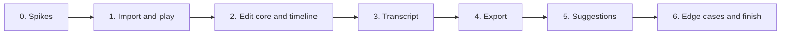

At the end of milestone 4 the whole weekly job works without Claude. Milestone 5 adds Claude on top of a tool that is already usable.

| # | Milestone | What is built | Done when |
| --- | --- | --- | --- |
| 0 | **Spikes** | Rust and Node.js installed; an empty app window. Four throwaway experiments on your real recording: the speech bake-off (Parakeet v2, Parakeet v3, Qwen3-ASR, on GPU and on processor), a two-video-element player crossing cuts in WebView2, an export benchmark at three quality settings, and a scripted Claude call on your subscription. | Risks 1 to 6 in 2.8 each have a measured result written into Part 2. The speech model, the app shell and the export quality setting are fixed. |
| 1 | **Import and play** | App shell, project store, source fingerprint and probe, job runner, proxy and waveform jobs, media server, Home screen, a player for one source. | Dropping a file gives a playable project in under 5 seconds. Closing and reopening the app resumes it. The player switches to the proxy without moving. |
| 2 | **Edit core and timeline** | The clip list with every edit command and undo, autosave, the player skipping cuts, the Timeline view, the shortcut registry. | Every Timeline row in 1.10 works. Playback crosses a cut without a visible or audible hitch. Undo reverses any edit exactly. |
| 3 | **Transcript** | Transcriber process, audio job, streaming transcript, Transcript view, cutting and restoring by text, marking with `I` / `O`, find, hide cut text. | Text starts appearing within 30 seconds of import. Every Transcript row in 1.10 works. A cut made in one view shows in the other at once. |
| 4 | **Export** | Export plan, clip-by-clip export job, Export dialog with its three states, cancel. | The exported file is as long as the sequence to the frame, picture and sound stay in sync to the end, and it opens in your editor's software. **First usable version.** |
| 5 | **Suggestions** | Claude runner, dead-air detection on the PC, suggestion review in the Transcript view, the notices for signed out, over limit and offline. | Suggestions appear within a minute of the transcript finishing. Every failure state shows its notice and leaves the app fully usable. |
| 6 | **Edge cases and finish** | Second and later sources, "Locate file", mixed formats, variable frame rate, several audio tracks, shortcut overlay and remapping, cache size limit, first-run model download, installer, a speed pass. | Every row of 1.12 behaves as written. Every target in 1.11 is measured on this PC and recorded. |

## 3.3 Modules

```text
roughcut/
├─ src/                    Interface (TypeScript + React)
│  ├─ edit/                the clip list and its commands
│  ├─ transcript/          words and selections, mapped to and from the clip list
│  ├─ player/              playback of a sequence
│  ├─ keys/                shortcuts mapped to actions
│  ├─ state/               the app's store and the typed client for the core
│  ├─ views/               Home, Transcript, Timeline, Export, shortcut overlay
│  └─ ui/                  design tokens and shared components from the mockups
├─ src-tauri/src/          Core (Rust)
│  ├─ api/                 every command and event the interface can use
│  ├─ project/             project files
│  ├─ source/              fingerprint, probe result, locating files
│  ├─ cache/               the per-source cache folder and its size limit
│  ├─ jobs/                the job runner
│  ├─ media/               every FFmpeg task
│  ├─ server/              the media server
│  ├─ speech/              transcriber client and transcript building
│  ├─ suggest/             Claude runner and dead-air detection
│  └─ settings/            settings file
├─ transcriber/            the separate transcriber program (Rust, sherpa-onnx)
├─ fixtures/               scripts that generate the test media
└─ spikes/                 milestone 0 experiments, thrown away afterwards
```

**Interface modules**

| Module | Responsibility | Public surface | May use |
| --- | --- | --- | --- |
| `edit` | Owns the clip list. Applies edit commands, keeps undo history, answers questions about the sequence. Pure data in, data out. | Edit commands and queries (3.5.1) | Nothing |
| `transcript` | Turns transcript tokens plus the clip list into what the Transcript view shows. Turns a text selection or an `I` / `O` range into source ranges. Search. | Layout, selection-to-ranges, find | `edit` (queries only) |
| `player` | Plays a sequence from the proxy or the original, skips cuts, reports the current time. | Player controls and time reports (3.5.3) | `edit` (queries only) |
| `keys` | Knows every action, its default key and its context. Turns a keystroke into an action. Supplies the shortcut list shown by `?`. | Action registry (3.5.2) | `state` |
| `state` | The single store the views read. Runs actions: calls `edit`, `transcript`, `player` and the core, and holds what the core reports (jobs, source assets, transcripts, suggestions). | Store, action dispatch, core client | `edit`, `transcript`, `player`, the core |
| `views` | Draws the screens in 1.7 from the store and sends actions. | Screens | `state`, `ui` |
| `ui` | Colours, type and components carried over from the HTML mockups. | Components | Nothing |

**Core modules**

| Module | Responsibility | Public surface | May use |
| --- | --- | --- | --- |
| `api` | The only door into the core. Checks inputs, forwards to the module that does the work, sends events. | Commands and events (3.5.4, 3.5.5) | All core modules |
| `project` | Creates, lists, reads, saves and removes project files. Writes are atomic. Upgrades older files. | Project store | `source` |
| `source` | Fingerprints a file, holds its probe result, checks it is still where it was, verifies a relocated file. | Source registry | `media` (probe) |
| `cache` | Decides where each cached item lives, reports sizes, removes the least recently used sources when over the limit. | Cache paths, usage, clear | Nothing |
| `jobs` | Queues, runs, reports and cancels all long work. Decides order and what may run at once. Skips work whose result is already cached. | Start, cancel, list, progress | `media`, `speech`, `suggest`, `cache` |
| `media` | One task per FFmpeg use: probe, proxy, audio for speech, waveform, encode one clip, render audio, join. | Media tasks (3.5.9) | `cache` |
| `server` | Serves proxies, originals and waveforms to the interface over HTTP on this machine only. | Media endpoints (3.5.6) | `cache`, `source` |
| `speech` | Starts the transcriber, feeds it audio, turns its output into the saved transcript (tightened word ends, cut points, utterances, unrecognised blocks). | Transcribe a source | `cache` |
| `suggest` | Reports Claude's status, builds the request from a transcript, runs `claude`, checks and maps the answer. Finds dead air without Claude. | Claude status, suggest for a source | `cache` |
| `settings` | Reads and writes the settings file. Keeps an API key, if one is ever used, in Windows Credential Manager. | Get, update | Nothing |

**Separate programs**

| Program | Started by | Contract |
| --- | --- | --- |
| FFmpeg and ffprobe | `media` | Command line, one process per task |
| `transcriber` | `speech` | Audio in, timed words out (3.5.7) |
| `claude` | `suggest` | Transcript text in, JSON out (2.4.6, 3.5.8) |

## 3.4 Data models and types

The types are written in TypeScript notation. Every type that is saved to disk or crosses between the interface and the core is defined once, in Rust, and its TypeScript form is generated from that, so the two sides cannot drift apart.

All times are positions in a source file unless the type says otherwise.

### Basics

```ts
type Micros = number;          // whole microseconds
type SequenceTime = Micros;    // a position in the edited sequence, not in a source

type ProjectId = string;
type SourceId = string;        // the source's fingerprint (2.4.9)
type ClipId = string;
type SuggestionId = string;
type JobId = string;

interface Rational { num: number; den: number }       // a frame rate, e.g. 30000 / 1001

interface SourceRange {        // start is included, end is not
  sourceId: SourceId;
  start: Micros;
  end: Micros;
}

interface SourcePosition { sourceId: SourceId; at: Micros }
```

### The project file

Saved as `project.json`. The core owns everything except `edit` and `session`, which belong to the interface.

```ts
interface Project {
  schemaVersion: number;
  id: ProjectId;
  name: string;
  createdAt: string;           // ISO 8601
  updatedAt: string;
  frameRate: Rational;         // the sequence's frame grid, taken from the first source
  sources: SourceRef[];
  edit: EditDocument;
  session: SessionState;
  lastExport?: ExportResult;
}

interface SourceRef {
  id: SourceId;
  path: string;                // last known location of the file
  addedAt: string;
  media: MediaInfo;            // copy of the probe result, so a project opens even when the file is missing
}

interface MediaInfo {
  duration: Micros;
  container: string;
  video: VideoInfo;
  audioTracks: AudioTrackInfo[];
  speechTrack: number;         // which audio track the transcript is made from
  directPlayable: boolean;     // whether the player can use the original before the proxy exists
}

interface VideoInfo {
  codec: string;               // 'h264', 'hevc', ...
  width: number;
  height: number;
  frameRate: Rational;
  variableFrameRate: boolean;
  bitDepth: 8 | 10;
  hdr: boolean;
}

interface AudioTrackInfo {
  index: number;
  codec: string;
  channels: number;
  sampleRate: number;
  title?: string;
}

interface EditDocument {
  current: EditState;
  undo: EditState[];           // oldest first
  redo: EditState[];
}

interface EditState {
  clips: Clip[];               // the sequence, in playing order
  dismissed: SourceRange[];    // suggestions you chose to keep
}

interface Clip {
  id: ClipId;
  sourceId: SourceId;
  start: Micros;
  end: Micros;
}

interface SessionState {       // where you were, restored on reopening
  view: 'transcript' | 'timeline';
  playhead: SourcePosition | null;
  playbackRate: 1 | 1.5 | 2;
  cutTextHidden: boolean;
}

interface ProjectSummary {     // one row of the Home screen
  id: ProjectId;
  name: string;
  rawDuration: Micros;
  keptDuration: Micros;
  updatedAt: string;
  lastExportedAt?: string;
  missingSources: number;
}
```

### The cache, per source

Everything here can be deleted and rebuilt.

```ts
interface Transcript {
  schemaVersion: number;
  sourceId: SourceId;
  model: string;               // name and version of the speech model that made it
  complete: boolean;
  utterances: Utterance[];
}

interface Utterance {          // one paragraph in the Transcript view
  index: number;               // the number Claude uses to refer to it
  start: Micros;
  end: Micros;
  tokens: Token[];
}

type Token = WordToken | PauseToken | UnrecognisedToken;

interface TokenBase {
  start: Micros;
  end: Micros;
  cutBefore: Micros;           // where a cut between the previous token and this one lands (2.4.5)
}
interface WordToken extends TokenBase { kind: 'word'; text: string }
interface PauseToken extends TokenBase { kind: 'pause' }                 // the pause chip
interface UnrecognisedToken extends TokenBase { kind: 'unrecognised' }   // speech with no words

interface SuggestionSet {
  schemaVersion: number;
  sourceId: SourceId;
  claudeModel?: string;        // absent when only dead air was found
  suggestions: Suggestion[];
}

interface Suggestion {
  id: SuggestionId;
  kind: 'retake' | 'false_start' | 'aside' | 'dead_air';
  origin: 'claude' | 'local';
  range: SourceRange;          // what accepting it cuts
  reason: string;              // the one line shown under the block
  keptVersionAt?: Micros;      // retakes only: where the version to keep starts
}

interface WaveformHeader {     // followed in the same file by `count` loudness values
  sourceId: SourceId;
  valuesPerSecond: number;
  count: number;
}
```

The proxy video and the audio extracted for speech are plain media files in the same folder.

### Runtime only (never saved)

```ts
type JobKind = 'probe' | 'proxy' | 'waveform' | 'audio' | 'transcribe' | 'suggest' | 'export';
type JobState = 'queued' | 'running' | 'done' | 'failed' | 'cancelled';

interface JobStatus {
  id: JobId;
  kind: JobKind;
  sourceId?: SourceId;
  projectId?: ProjectId;
  state: JobState;
  progress: number;            // 0 to 1
  secondsLeft?: number;
  error?: AppError;
}

interface SourceAssets {       // what is ready for one source, as the interface sees it
  sourceId: SourceId;
  online: boolean;             // the original file is where the project expects it
  playback: 'none' | 'original' | 'proxy';
  playbackUrl: string | null;
  waveformUrl: string | null;
  transcript: 'none' | 'partial' | 'complete';
  suggestions: 'none' | 'working' | 'ready' | 'unavailable';
}

interface ExportRequest {
  projectId: ProjectId;
  clips: Clip[];
  folder: string;
  fileName: string;
}

interface ExportPlan {         // what the Export dialog shows before you confirm
  duration: Micros;
  format: OutputFormat;
  estimatedBytes: number;
  estimatedSeconds: number;
  freeBytes: number;
  notices: string[];           // e.g. "sources differ; the export follows the first clip"
  blockedBy?: AppError;        // nothing to export, not enough disk space, a source is missing
}

interface OutputFormat {
  codec: 'h264' | 'hevc';
  width: number;
  height: number;
  frameRate: Rational;
  bitDepth: 8 | 10;
  hdr: boolean;
  audioTracks: number;
}

interface ExportResult {
  path: string;
  duration: Micros;
  bytes: number;
  tookSeconds: number;
  finishedAt: string;
}

interface ClaudeStatus {
  installed: boolean;
  version?: string;
  versionTested: boolean;      // false when Claude Code has changed since the app was last checked against it
  signedIn: boolean;
  authMethod?: string;
}

interface AppError { code: ErrorCode; message: string; detail?: string }

type ErrorCode =
  | 'source_missing' | 'source_unreadable' | 'source_mismatch'
  | 'disk_full' | 'nothing_to_export' | 'export_failed'
  | 'gpu_unavailable' | 'transcriber_failed'
  | 'claude_missing' | 'claude_signed_out' | 'claude_limit' | 'claude_offline' | 'claude_bad_answer'
  | 'cancelled' | 'internal';
```

### Settings

```ts
interface Settings {
  schemaVersion: number;
  exportFolder: string;
  keyBindings: KeyBinding[];                 // only those changed from the defaults
  speechModel: string;
  speechDevice: 'auto' | 'gpu' | 'cpu';
  claudeModel: string;                       // 'opus' by default
  claudeAuth: 'subscription' | 'api_key';
  claudeCodeVersionTested: string;
  cacheLimitBytes: number;
}

type KeyContext = 'everywhere' | 'home' | 'transcript' | 'timeline' | 'export';
type ActionId = string;                      // one per row of 1.10, e.g. 'timeline.split'

interface KeyBinding { action: ActionId; context: KeyContext; chord: string }
```

### Rules the data always obeys

1. A clip is never empty, and both its edges sit on the sequence's frame grid.
2. No moment of a source is in more than one clip.
3. Clips are the only record of what is kept. A token is kept exactly when a clip covers it; nothing else is stored about cuts.
4. A suggestion's state is worked out, not stored: dismissed if its range is in `dismissed`, applied if none of its range is kept, pending otherwise.
5. After creating a project with one clip per source, the core never changes `edit`. Only the interface does.
6. A project file with a newer `schemaVersion` than the app understands is refused, not guessed at.

## 3.5 APIs

### 3.5.1 Edit commands (`edit`)

Each command takes the current `EditState` and returns the next one. Each is one undo step.

| Command | Takes | Result |
| --- | --- | --- |
| `appendSource` | Source id, duration | One clip covering the whole source is added at the end |
| `cutRanges` | `SourceRange[]` | Those moments leave the sequence. Clips are shortened, split or removed as needed |
| `restoreRanges` | `SourceRange[]` | Those moments return to the sequence (placement rule below) |
| `trimEdge` | Clip id, which edge, new position | The edge moves, stopping at the next kept material or the end of the source |
| `nudgeEdge` | Clip id, which edge, frames | The same, by a number of frames |
| `splitAt` | `SequenceTime` | The clip under that time becomes two |
| `removeClip` | Clip id | The clip leaves the sequence |
| `moveClip` | Clip id, earlier or later | The clip swaps places with its neighbour |
| `dismissSuggestion` | `SourceRange` | The range is added to `dismissed` |
| `undo`, `redo` | | The previous or next `EditState` becomes current |

Accepting a suggestion is `cutRanges` with the suggestion's range. Accepting all of them is one `cutRanges` with every pending range, so a single undo reverses it.

Queries, which change nothing: sequence duration; the clip at a sequence time; a sequence time for a source position and the reverse; the list of cut points; whether a source range is kept; whether undo or redo is possible.

Two placement rules:

- **Where restored material goes.** It joins the clip it touches in source time, and closing a gap merges the clips on either side. If it touches no clip, it is placed after the nearest earlier clip of the same source, or where that source's first clip would be.
- **Where cut text is shown.** In the transcript, cut text sits next to the kept clip that borders it in source time. This is the same position it would return to if restored.

### 3.5.2 Actions (`keys`)

An action is anything a key can trigger: one per row of the tables in 1.10. Some actions run an edit command (cut selection, split); the others move the caret, control the player or open a dialog.

The registry holds, for each action: its id, its label, its context (`KeyContext`) and its default key. It offers: the action for a keystroke in the current context; the full list for the `?` overlay; rebinding one action, refusing a key already used in the same context.

### 3.5.3 Player (`player`)

| Control | Effect |
| --- | --- |
| Load | Takes the clips and each source's playback address. Called again whenever either changes, keeping the position |
| Play, pause | |
| Seek | To a `SequenceTime` |
| Step | Forwards or backwards by frames or seconds |
| Set rate | 1, 1.5 or 2 |
| Shuttle | The `J` `K` `L` behaviour, including silent backwards play |
| Preview cut | Plays from two seconds before a cut to two seconds after |

It reports, on every displayed frame, the current `SequenceTime` and `SourcePosition`, and whether it is playing.

### 3.5.4 Interface to core: commands (`api`)

Each returns its result or an `AppError`.

| Group | Command | Takes | Returns |
| --- | --- | --- | --- |
| Projects | `list_projects` | | `ProjectSummary[]` |
| | `create_project` | File paths | `Project` (starts the import jobs) |
| | `open_project` | Project id | `Project` and a `SourceAssets` per source (restarts any unfinished jobs) |
| | `save_edit` | Project id, `EditDocument`, `SessionState` | |
| | `rename_project` | Project id, name | |
| | `remove_project` | Project id | Removes it from the list; footage is untouched |
| Sources | `add_sources` | Project id, file paths | `SourceRef[]` (starts the import jobs) |
| | `locate_source` | Project id, source id, new path | `SourceAssets`, or `source_mismatch` if it is a different file |
| | `get_transcript` | Source id | `Transcript`, as far as it has got |
| | `get_suggestions` | Source id | `SuggestionSet` |
| | `retry_suggestions` | Source id | `JobId` |
| Jobs | `list_jobs` | | `JobStatus[]` |
| | `cancel_job` | Job id | |
| Export | `plan_export` | `ExportRequest` | `ExportPlan` |
| | `start_export` | `ExportRequest` | `JobId` |
| | `reveal_file` | Path | Opens the folder with the file selected |
| Claude | `claude_status` | | `ClaudeStatus` |
| Settings | `get_settings` | | `Settings` |
| | `update_settings` | The fields to change | `Settings` |
| Cache | `cache_usage` | | Bytes used, limit |
| | `clear_cache` | | |

File and folder pickers use the system dialogs directly from the interface.

### 3.5.5 Core to interface: events (`api`)

| Event | Carries | Sent when |
| --- | --- | --- |
| `job_updated` | `JobStatus` | A job is queued, makes progress, finishes, fails or is cancelled |
| `source_assets_changed` | `SourceAssets` | The proxy or waveform becomes ready, or a source goes missing or is found |
| `transcript_appended` | Source id, new `Utterance[]` | The transcriber finishes a stretch of speech |
| `transcript_completed` | Source id | The whole source is transcribed |
| `suggestions_ready` | `SuggestionSet` | Dead air has been found, and again when Claude has answered |
| `suggestions_unavailable` | Source id, `AppError` | Claude is signed out, over its limit, offline or gave an unusable answer |
| `export_finished` | `ExportResult` | The exported file is complete at its destination |

### 3.5.6 Media server (`server`)

Listens on `127.0.0.1` only, on a port chosen at launch. Every request must carry the token created at launch.

| Request | Returns |
| --- | --- |
| `GET /media/{sourceId}/proxy` | The proxy video, with byte-range support |
| `GET /media/{sourceId}/original` | The original file, with byte-range support |
| `GET /media/{sourceId}/waveform` | The waveform file |

Missing or wrong token: 401. Unknown source or item not ready: 404.

### 3.5.7 Transcriber program

A model swap means another program that honours this same contract.

- **Started with:** the model folder and the device (`gpu` or `cpu`).
- **Reads:** 16 kHz mono audio on standard input, as it is extracted.
- **Writes:** one JSON message per line on standard output.

| Message | Carries | Meaning |
| --- | --- | --- |
| `ready` | Model, device actually used | Loaded; says so if it fell back from GPU to processor |
| `segment` | Start, end, and words each with text, start and end | One stretch of speech, transcribed |
| `speech_without_words` | Start, end | The voice detector heard speech; the model returned nothing |
| `progress` | Seconds of audio consumed | |
| `done` | Every speech range the detector found | Input ended and everything was transcribed |
| `error` | Code, message | It then exits with a non-zero code |

### 3.5.8 Claude (`suggest`)

How `claude` is run is fixed in 2.4.6. The contract around it:

- **Request:** each utterance on its own line, with its number, its start time, its text and the length of the pause after it.
- **Answer:** a list of suggestions matching the schema below. The core turns each into a `Suggestion` by locating the quoted words, and drops any it cannot locate.

| Field | Meaning |
| --- | --- |
| `kind` | `retake`, `false_start` or `aside` |
| `first_utterance`, `last_utterance` | The utterances the suggestion lies in |
| `quote` | The exact words to cut, copied from the transcript |
| `reason` | One line |
| `keep_utterance` | Retakes only: the utterance holding the version to keep |

| What happens | Reported as |
| --- | --- |
| `claude` is not installed | `claude_missing` |
| `claude auth status` says signed out | `claude_signed_out` |
| The call reports a usage limit | `claude_limit` |
| No network, or the call times out | `claude_offline` |
| The answer is missing, or fails the schema | `claude_bad_answer`, after one automatic retry |

### 3.5.9 Media tasks (`media`)

Each is one FFmpeg or ffprobe process, cancellable, reporting progress.

| Task | Takes | Produces |
| --- | --- | --- |
| Probe | A file path | `MediaInfo` |
| Proxy | A source | The 720p proxy in the cache |
| Speech audio | A source and its speech track | A 16 kHz mono stream for the transcriber |
| Waveform | A source | The waveform file in the cache |
| Encode clip | A `Clip` and the `OutputFormat` | One video piece in a temporary folder |
| Render audio | The clips and the `OutputFormat` | All audio tracks for the whole sequence |
| Join | The pieces and the audio | The MP4, written under a temporary name and moved to its destination only when complete |

## 3.6 Who calls what

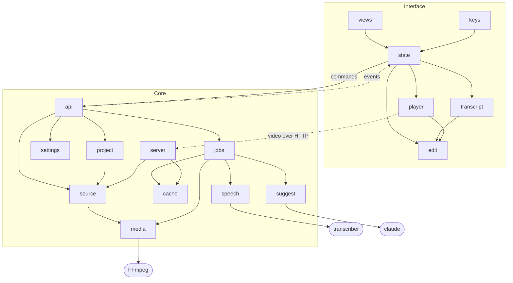

Rules that keep it this way:

1. **Views never call `edit`, the player or the core.** They read the store and send actions. This is what lets every action be driven from the keyboard and from a test in the same way.
2. **`edit` uses nothing.** It can be tested without a window, a video or a core.
3. **`state` is the only interface module that talks to the core,** and `api` is the only core module it can reach.
4. **Only `jobs` starts long work.** `media`, `speech` and `suggest` are the only modules that start other programs, and they do so when `jobs` asks.
5. **Only `project` writes project files. Only `cache` chooses cache paths.**
6. **The core never calls the interface.** It sends events and the interface decides what to do with them.

**Cutting by deleting text**

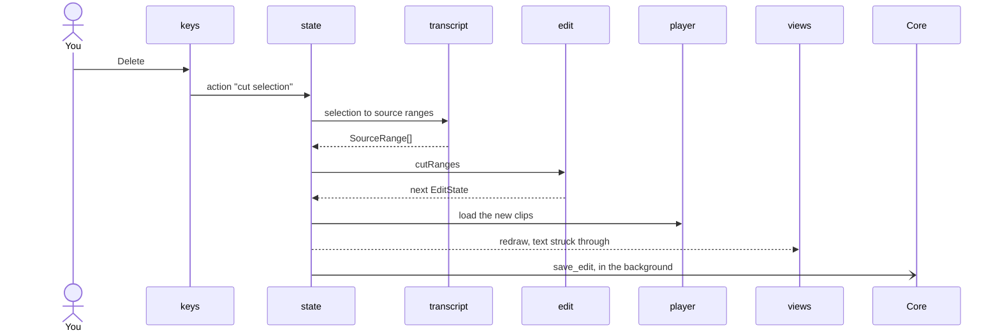

**Exporting**

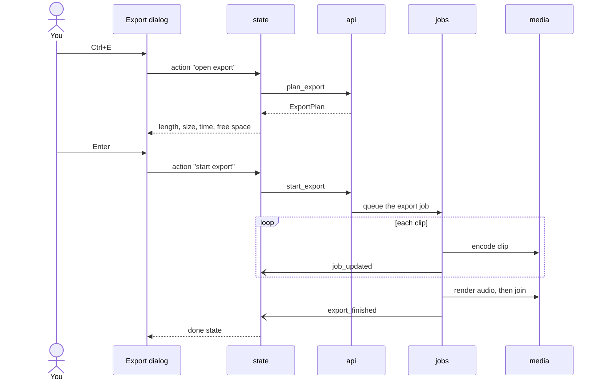

The import sequence is in 2.5.

## 3.7 What is tested

| Area | Kind of test | What it proves |
| --- | --- | --- |
| `edit` | Unit tests for each command, plus generated random command sequences | The rules in 3.4 hold after any series of edits. Undo returns exactly the earlier state. Cutting then restoring the same range changes nothing. Edges stop at kept material and at source ends. |
| `transcript` | Unit tests | A selection maps to the right source ranges and snaps to whole tokens. Kept and cut text match the clip list. Cut text sits where the placement rule says. Find covers kept and cut text. |
| `keys` | Unit tests | Every action has a key. No key is used twice in one context. The registry matches the tables in 1.10. Rebinding refuses clashes. |
| `player` | Unit tests against a stand-in video element; one instrumented run in the real WebView2 | Handover happens at the right frame. Position is kept when the proxy replaces the original. In the real run, the gap at a cut is under one frame at 1×, 1.5× and 2×. |
| `state` and `views` | Scripted keyboard sessions in the interface with a stand-in core | Each use case in 1.6 can be completed from the keyboard alone. A change in one view appears in the other. |
| `project` | Unit tests on real files | Saving is atomic: a write interrupted at any point leaves the previous file readable. Older files are upgraded; newer ones are refused. |
| `source`, `cache` | Unit tests on real files | A moved or renamed file keeps its fingerprint. A different file is rejected by "Locate file". The cache limit removes the least recently used source and nothing in use. |
| `jobs` | Unit tests with stand-in tasks | Import order is as in 2.4.10. A cached result is not recomputed. Cancel stops the process and cleans up. An interrupted job restarts cleanly on reopening. |
| `server` | Integration tests | No token means no data. Byte ranges are honoured. It is not reachable from another machine. |
| `speech` | Unit tests on recorded transcriber output; integration test with a stand-in transcriber | Word ends are tightened, cut points fall in the gap, utterances split where expected, speech without words becomes a block. A transcriber crash becomes `transcriber_failed`, not an app crash. |
| `suggest` | Integration tests with a stand-in `claude` program | Each outcome in 3.5.8 produces the right error. `ANTHROPIC_API_KEY` is absent from the child's environment. Quotes are located correctly and unlocatable ones dropped. A changed Claude Code version is flagged. |
| `media` | Integration tests with the real FFmpeg on generated fixtures | Probe reads each fixture correctly. The proxy has constant frame rate and half-second keyframes. Export tests are in the next row. |
| Export | Integration tests on a fixture with a number burned into every frame and a beep every second | The output has exactly the expected frames, in order, with the right frame on each side of every cut. Picture and sound are within one frame of each other at the end. All audio tracks are present. Resolution, frame rate, bit depth and codec family match the source. Cancel leaves no file. Too little disk space is caught before starting. |
| Whole app | One scripted run on the speech fixture: import, wait for the transcript, cut by text, trim on the timeline, export | The exported file's length equals the sequence's length, and the cut words are not in it. |
| Speed | Measured by hand on this PC with a real one-hour 4K recording | Each target in 1.11, recorded in a table at the end of milestone 6. |

**Fixtures**

| Fixture | Made by | Used for |
| --- | --- | --- |
| Numbered frames with beeps, 30 seconds, 4K H.264 | Script, with FFmpeg | Export, proxy, player |
| The same in HEVC 10-bit HDR | Script | Export keeps bit depth and HDR |
| The same with variable frame rate | Script | Conversion to constant frame rate keeps time |
| The same with three audio tracks | Script | All tracks kept; speech track chosen |
| The same at 1080p and 60 frames per second | Script | Mixed sources follow the first clip |
| Picture with silence only | Script | "No speech" state |
| Two minutes of speech with known retakes and a hand-checked transcript | Cut from your real recording in milestone 0 | Speech, suggestions, the whole-app run |
| Recorded transcriber output and recorded Claude answers | Captured in milestone 0 | `speech` and `suggest` tests without a GPU or a network |

**Not tested automatically**

- **How accurate the speech model is.** That is decided once by the bake-off, and again by hand if the model is changed.
- **How good Claude's suggestions are.** They are checked by eye against the two-minute speech fixture when the prompt changes. A wrong suggestion costs one press of `D`.
- **The live Claude service.** Automated tests use the stand-in program. One manual check per release confirms the real call still works on your subscription.

## 3.8 Refinements this makes to Part 2

- **Undo covers dismissing a suggestion.** Each undo step holds the clip list and the dismissed list together (2.4.7 said the clip list only).
- **The voice detector runs inside the transcriber program,** not as a separate job (2.4.10 listed it separately).
- **An API key, if the fallback in risk 3 is ever needed, is kept in Windows Credential Manager,** not in the settings file.
- **Waveforms reach the interface through the media server,** alongside the video.
